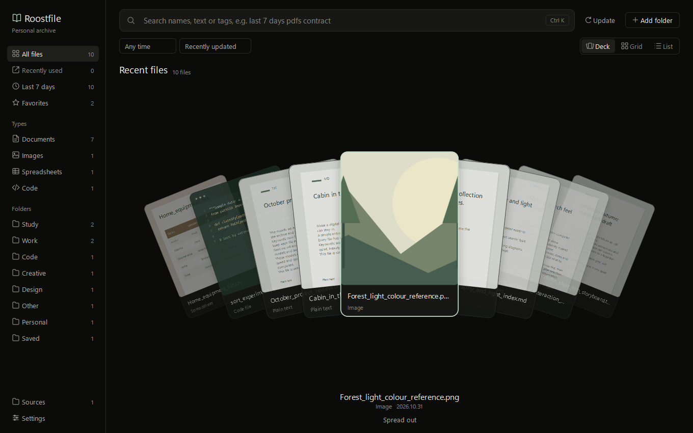
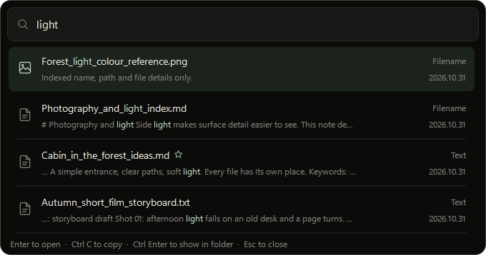

# Roostfile (栖档)

A private file archive for your own computer. Add the folders you choose, then find any file from the one phrase you remember, even a word inside a scanned photo, and hand it to the app you are in with a single keystroke.

[简体中文](README.zh-CN.md)



- **Runs only on your computer.** No account, no telemetry, no update check, and it never connects to the internet.
- **Leaves your originals alone unless you say otherwise.** By default nothing is moved, renamed or deleted. You can choose to have dropped files moved into a library instead, and put any of them back. Nothing is uploaded.
- **Finds what you half remember.** Search names, document text and words in photos and scans, in English and Chinese.

> **Status: early prototype.** There is no installer yet. Tested on Windows 11 with Python 3.12. macOS support is written but has not been run on a Mac yet.

## What it does



- **Hand files to Roo.** A tiny chibi assistant stands on your desktop. Drop files or a folder on her and she reads them, hugging a folder as she works, then files each one in a collection named for its subject, such as Contract or Invoice. By default she keeps a copy and leaves the original where it is. Settings can have her move files into your library instead, sorted into a folder for each subject. Click her to search, drag her anywhere, or replace her with your own picture.
- **Connect your own tools.** An MCP server lets assistants and workflows search and read your archive, once you allow it in Settings.
- **Index in place or keep a copy.** Choose per folder, and switch at any time. Folders you add are never moved, renamed or deleted.
- **See what just arrived.** When a new file lands, a small bar appears at the top of the screen with Copy and Open. It never takes the keyboard, and it stays away during games and presentations.
- **Link files that belong together.** A quote, its contract and the photos from site can live in different folders. Link them once and they sit together as a set on the Links board, each shown as a card with its cover. Finding one shows the rest, and you can copy the whole set at once. Press `Ctrl L` on a selection, or drag one card onto another. Roostfile also suggests files that may belong, and says why.
- **Gather files into collections.** Group files from anywhere for a task, such as a tax return, without moving them. Search, then add all the results at once. A collection follows its files when they are renamed, and exports to a CSV list.
- **Search from anywhere.** Press `Ctrl Alt K` in any app and a small search bar appears. Type a clue, press `Ctrl C`, and you are back where you were, ready to paste the file.
- **Search names, text and tags.** Multiple words narrow the results. Chinese and English both work, including two-character Chinese terms and parts of words.
- **Read photos and scans.** Words in screenshots, photos of documents and scanned PDFs become searchable, in Chinese and English. This uses the recogniser built into Windows, runs in the background and needs no download.
- **Say what you mean.** `last 7 days pdfs contract`, `photos forest` and `上个月 发票` become filters, shown as chips. Use `type:code` or `.go` for words that are also ordinary English. A search that finds nothing tries related words, such as `合同` for `contract`, and says so.
- **Browse visually.** A fanned deck, a grid and a list, with covers built from each file's real content. A PDF shows its real pages.
- **Tell versions apart.** `合同终稿(1)`, `合同终稿-最新` and `合同 final` in one folder are recognised as one document. The newest is marked, and the others are one click away.
- **Confirm before opening.** Results show the matching passage, and the preview highlights every match. PDFs show real pages, and CSV and Excel files show as tables.
- **Put it to use.** Drag a file into a chat or an email, or press `Ctrl C` and paste it. A file is always copied, never moved.
- **Stay up to date on its own.** New and changed files are found a few seconds after they appear. An idle library costs no disk work, because Windows reports changes, and only the folders that changed are looked at.
- **Stay organised without being guessed at.** The sidebar lists file types and your own folders, level by level, both of which are certain. Tags and favorites survive updates, and follow a file that is renamed or moved.
- **Start where you left off.** The deck opens on files you recently opened, copied or dragged out, with new arrivals around them.
- **Interface in English or Simplified Chinese**, from Settings.

## Make Roo your own


She waves when she arrives. Her eyes follow your pointer, she blinks, breathes and talks. Pick her up by the collar and your pointer becomes the hand: her cardigan rides up, her legs dangle, and she swings as you move. Leave her alone and she reads, does her homework, bounces a ball, sips tea or dozes off where she stands. That is a timer: she watches nothing you do. Her right-click menu can stop her playing or pin her in place. She is a layered illustration moved by a small rig written for this app, in the manner of Live2D. She is not a Live2D model and uses none of its software.

Right-click Roo and choose **Change image**. PNG, JPG, WebP, BMP and GIF up to 20 MB work, and a GIF plays. Any picture bobs, squashes and hops, and the copy is kept in your archive, so the original can move.

For a different look per mood, choose **Use an image for each mood** and pick a folder holding any of `idle`, `excited`, `working` and `happy`, such as `happy.png`. Moods without a picture use `idle`.

Roo steps aside during games and presentations, and can be hidden from her menu or from Settings. Reduce motion keeps her still.

## Move your archive

The archive starts in the `data` folder beside the app. To keep it somewhere else, choose **Change location** in Settings and pick a folder on this computer. Roostfile makes a `Roostfile` folder inside it, copies the database, saved copies and settings there, and switches only after checking the copy. Your original files do not move, and the old folder stays until you delete it.

If the folder you pick already holds an archive, Roostfile asks whether to switch to it and never overwrites it. If the archive is on an external drive that is not connected at startup, Roostfile tells you instead of starting an empty one.

## Connect your own tools

Roostfile includes a server for the [Model Context Protocol](https://modelcontextprotocol.io). In Settings, turn on **Let connected tools read this archive**, then choose **Copy setup for your tool** and paste the result into your tool's MCP settings. It looks like this:

```json
{
  "mcpServers": {
    "roostfile": {
      "command": "C:\\path\\to\\python.exe",
      "args": ["C:\\path\\to\\mcp_server.py", "--data", "C:\\path\\to\\data"]
    }
  }
}
```

| Tool | What it does |
| --- | --- |
| `search_files` | Finds files by words in names, text and tags |
| `read_file_text` | Reads a file's text, including words read from images, in parts |
| `list_collections` | Lists your collections |
| `list_collection_files` | Lists the files in a collection |
| `add_to_collection` | Adds files to a collection. Needs **Also let them add files to collections** |
| `list_linked_files` | Lists the files linked to one file |
| `link_files` | Links files together. Needs the same switch as `add_to_collection` |

It runs over stdin and stdout, opens no network connection, and reaches only what is already in your archive. Both switches are read on every request, so turning one off works at once, even mid-session. No tool moves, changes or deletes a file.

## Getting started

You need Windows and Python 3.12 or later.

```powershell
git clone https://github.com/weichiwes/roostfile.git
cd roostfile
python -m pip install --only-binary=:all: --target .vendor -r requirements-ui.txt
python desktop_app.py --demo
```

`--demo` opens a separate archive of made-up files, so you can look around first. To use your own files, double-click `start.cmd`, or run `python desktop_app.py`. The first run suggests your usual folders and reads nothing until you confirm. The interface starts in English, and Settings switches it to Simplified Chinese.

### Build a portable copy

A portable copy includes Python and everything else, so it runs on a computer with nothing installed. Unzip it anywhere and double-click `start.cmd`. Your archive is kept in the same folder.

```powershell
python package_windows.py --python path\to\python-3.12-embed-amd64
```

This writes `dist\Roostfile-windows-x64.zip`, about 90 MB, from the python.org embeddable package.

### macOS

Not yet tested on a Mac, so expect rough edges. You need macOS 12 or later and Python 3.12 or later.

```bash
python3 -m pip install --target .vendor -r requirements-ui.txt
./demo.command
```

The shortcut is `⌘ ⌥ K`. Text recognition uses Apple's Vision framework, and iCloud files that are not downloaded are skipped.


## Keyboard

| Key | Action |
| --- | --- |
| `Ctrl Alt K` | Quick search, from any app. Change it in Settings |
| `Ctrl K` or `Ctrl F` | Search |
| `Down` | Move from the search box to the results |
| `Up` on the first result | Back to the search box |
| `Space` | Full preview |
| `Enter` or double-click | Open the file |
| `Ctrl C` | Copy the file, ready to paste |
| `Ctrl Shift C` in quick search | Copy just the words |
| Right-click | Everything you can do with a file |
| `Ctrl R` | Update the archive |
| `Esc` | Close the preview, then clear the search |

In quick search, `Enter` opens the file, `Ctrl C` copies it, `Ctrl Enter` shows it in its folder and `Esc` closes the bar.

Scripts and programs are shown in their folder rather than run.

## Privacy and offline use

Roostfile has no account, no telemetry and no update check, and it never connects to the internet. The app blocks its own network sockets at startup, refuses network folders, and does not follow the links to other computers that SVG files and rich text can carry. On a test run a system call trace on Linux recorded no internet connections, and neither did watching the app's network endpoints on Windows. The same test has not been run on a Mac.

Only folders you add and files you drop on Roo are read. Her eyes follow the pointer's position, which is not stored. A single dropped file brings nothing else from its folder. Connected tools have no access until you allow it, and a tool you connect can read the text of your files and may send it to an online service, depending on that tool. Words in photos and scans are read on this computer by Windows, and nothing is uploaded. Closing the window keeps the app running in the tray, for the shortcut and for change notices; you can turn that off in Settings, and starting with Windows is off until you turn it on. The app makes no network requests: it has no accounts, telemetry or update checks, and it blocks Python sockets at startup. That check is inside the app, not a firewall. Opening a file hands it to your default app, which behaves as that app does. Network paths and mapped drives are refused, and cloud placeholders are skipped so that browsing never triggers a download.

One thing changes this, and only if you turn it on. A tool connected over MCP can read the text of your files, and that tool may send it to an online service. It is off by default, and Settings says so next to the switch.

## Limits

Search uses keywords. There is no semantic model, and nothing recognises what a photo shows or what is said in audio.

- Roo sorts by matching words, not by understanding. She looks for about 25 everyday subjects in the file name, then in the text, and uses the file type when none fits. She can be wrong, and removing a file from a collection takes one click.
- Reading text from images can get similar characters wrong, such as 金 and 全, so a word in a photo can be missed. It needs Windows' text recognition for your language, which Chinese and English Windows normally include. Scanned PDFs are read up to their first 20 pages.
- Versions are told apart by name within one folder, not by comparing what is inside the files.
- PDF text comes from the first 100 pages, up to about 200,000 characters. Files over 24 MB are indexed by name and details only.
- Encrypted PDFs and legacy `.doc/.xls/.ppt` files are indexed by name and details only.
- SVG files are indexed by name and get a plain cover, because an SVG can point at other files, including on someone else's computer, and drawing it would open them.
- Folders nested past the Windows path limit are left out, and Sources says so.
- Keeping a copy is not a backup system, and there is no version history browser.
- Data is stored in plain local files, without extra encryption. That includes the text read from your documents, so keep the archive folder as private as the documents themselves. Removing a source erases its text from the archive, but saved copies stay until you delete them from the `vault` folder.

## Development

[docs/users.md](docs/users.md) describes who this is for and the moments it has to serve.

| File | Purpose |
| --- | --- |
| `desktop_app.py` | Main window, filters, preview, sources, settings |
| `assistant.py` | Roo's window: moods, chosen pictures and taking drops |
| `character.py` | Roo's rig: one painting per pose in `assets/roo`, with a living face on top |
| `link_board.py` | The Links board: sets of linked files as cards |
| `mcp_server.py` | MCP server for connected tools. Standard library only, and no Qt |
| `visual_widgets.py` | Deck, hover behaviour and file covers |
| `background.py` | Everything that differs by system: global shortcut, one running copy, starting at sign-in, change notices |
| `ocr.py` | Reads the words in photos and scans with the recogniser built into Windows |
| `pages.py` | Draws PDF pages with PDFium |
| `package_windows.py` | Builds the portable copy |
| `core.py` | SQLite catalogue, scanning, text extraction, search, archive copies |
| `search_ux.py` | Query conditions, match explanations and highlighting. No I/O |
| `i18n.py` | Interface text. English is the source; `ZH` holds the Chinese |
| `theme.py` | Colour and font tokens. See [DESIGN.md](DESIGN.md) |
| `bench_library.py` | Benchmark on synthetic data |

```powershell
python -m unittest discover -s tests -v
python bench_library.py --files 50000 --scan-files 20000
```

`tests/test_core.py`, `tests/test_search_ux.py`, `tests/test_i18n.py` and `tests/test_mcp.py` run on any platform with no dependencies. `tests/test_mcp.py` also speaks to the server through the official MCP client when `requirements-dev.txt` is installed. `tests/test_desktop.py`, `tests/test_background.py` and `tests/test_reading.py` need Qt, and parts of the last two need Windows.

Every new interface string goes through `t()`, with a translation in `ZH`. `tests/test_i18n.py` fails if one is missing.

### Performance

Measured with `bench_library.py` on 50,000 synthetic files and a 1.7 GB catalogue. "Windows" is Windows 11 on an NVMe drive with Microsoft Defender on, at below-normal priority. Use these numbers to compare runs, not as a promise for your machine.

| Operation | Linux | Windows |
| --- | --- | --- |
| Open the library | 15 ms | 13 ms |
| Search for a two-character term | 173 ms | 176 ms |
| Peak memory for that search | 0.6 MB | 0.5 MB |
| Rescan 20,000 unchanged files | 2 s | 3.5 s |
| First scan of 20,000 files | 36 s | 107 s |

A first scan takes longer on Windows because antivirus software checks each file the first time it is opened. Files are read on four threads for that reason. Searching keeps working while a scan runs.

Reading the words in 216 simulated photos and scans took 30 seconds in the background, with the interface never held up for more than 37 ms.

## Author

Made by 未弛 Wes.

- YouTube: [未弛 Wes](https://www.youtube.com/channel/UC8lBHxdII_tXiCGd9Y5lNbg)
- X (Twitter): [@weichiwes](https://x.com/weichiwes)
- GitHub: [weichiwes](https://github.com/weichiwes)

## License

[MIT](LICENSE). The packages Roostfile depends on keep their own licenses, listed in [THIRD_PARTY_NOTICES.md](THIRD_PARTY_NOTICES.md).
